<div align="center">

# Relay IPTV

### Live TV, a full guide, films and series. On your TV and your phone.

A fast, good-looking IPTV player for Android TV, Google TV and Android phones. Sign in with the Xtream Codes login from your provider, and Relay turns it into something that feels at home on a sofa and in your hand.

[](https://github.com/Beechey/relay/releases/latest)
[](https://github.com/Beechey/relay/releases)
[](LICENSE)


[**⬇&nbsp; Download the APK**](https://github.com/Beechey/relay/releases/latest/download/relay-iptv.apk) &nbsp;·&nbsp; [Releases](https://github.com/Beechey/relay/releases) &nbsp;·&nbsp; [Report a bug](https://github.com/Beechey/relay/issues)

<br>

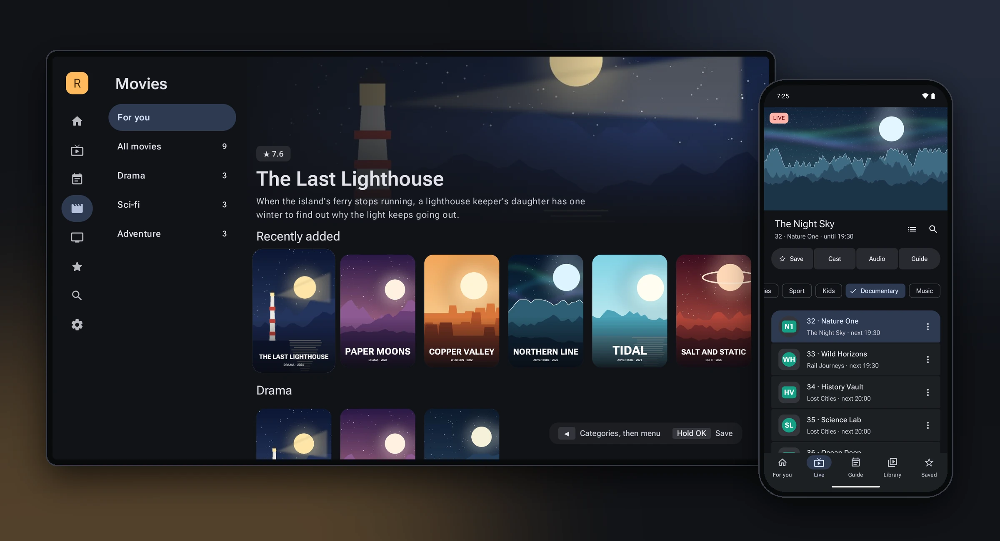

<sub>Screenshots show the made-up demo catalogue from <a href="tools/demo-server">tools/demo-server</a>: invented channels, generated artwork.</sub>

</div>

> [!NOTE]
> **Relay doesn't come with any channels or content.** It's a player: it shows what your own IPTV provider gives you, using the login they sent you.

## Highlights

*Relay 0.3, currently in [beta](https://github.com/Beechey/relay/releases), is a complete redesign: Material 3 for TV on the big screen, Material 3 Expressive on phones.*

| | On TV | On a phone |
|---|---|---|
| **Live TV** | Channel groups and a live preview, then fullscreen with a strip of neighbouring channels | Swipe through categories; keep watching in a mini player while you browse |
| **Guide** | A full grid: channels down, time across, catch-up and reminders | A tidy list with time chips; swipe to move through the evening |
| **Movies and series** | Poster rows and grids, detail pages, seasons and episodes | Swipe through categories, posters grow into their detail page |
| **Getting around** | Every remote button does what you'd expect, and focus always comes back to where you were | Every tab keeps its place; predictive back; picture-in-picture |

**Also:** continue watching (and the next episode queued up), search across everything, favourites, hide or reorder categories, audio / subtitle / quality choice, Chromecast for live TV, several playlists, and updates from inside the app.

## On a TV

Built for the remote: a menu down the left, big artwork, and focus you can always see.

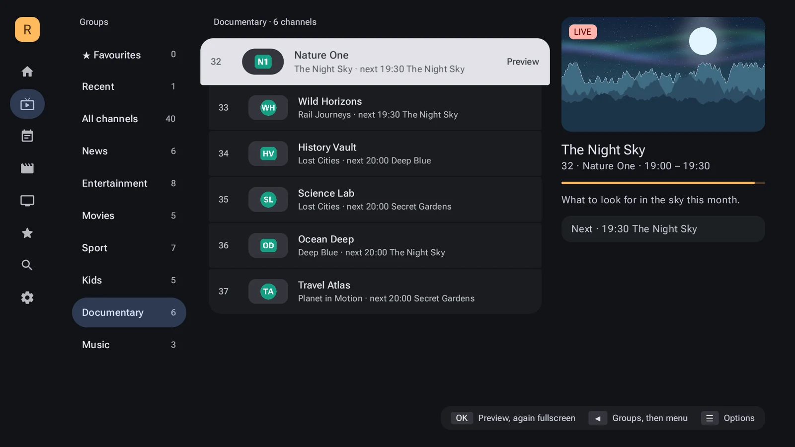

<table>
  <tr>
    <td width="50%">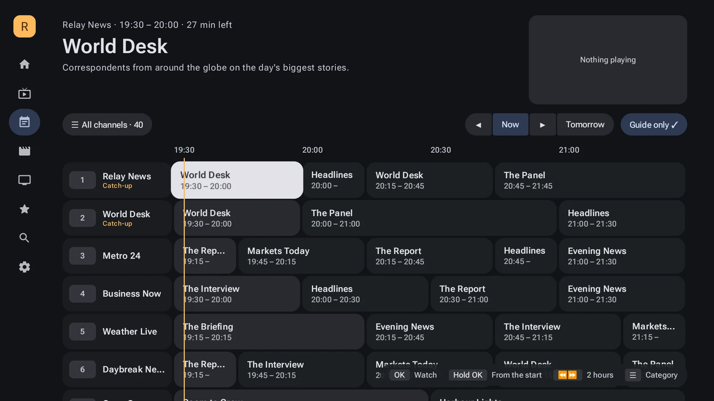</td>
    <td width="50%">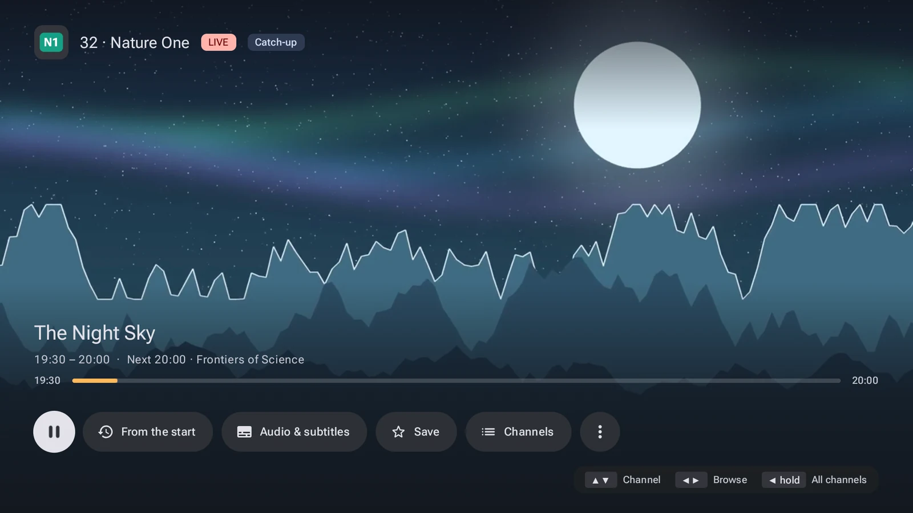</td>
  </tr>
  <tr>
    <td align="center"><sub><b>Guide</b> · channels down, time across, catch-up from the past</sub></td>
    <td align="center"><sub><b>Live</b> · Up and Down change channel, Left and Right browse</sub></td>
  </tr>
  <tr>
    <td width="50%">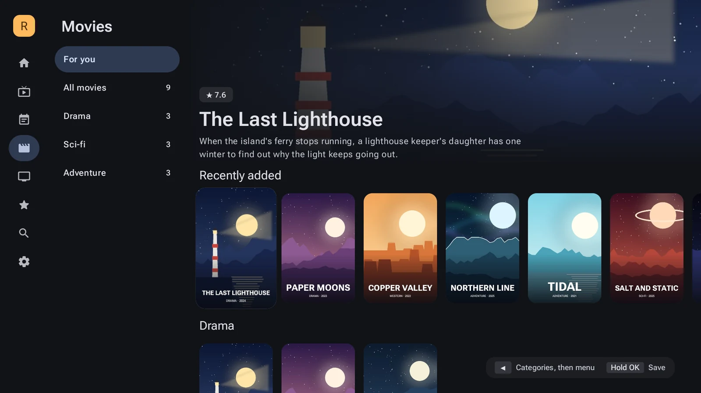</td>
    <td width="50%">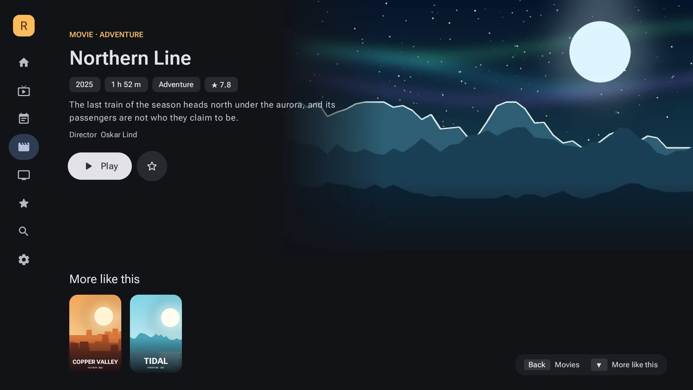</td>
  </tr>
  <tr>
    <td align="center"><sub><b>Movies</b> · categories, rows and a featured pick</sub></td>
    <td align="center"><sub><b>Details</b> · plot, credits and more like this</sub></td>
  </tr>
</table>

## On a phone

The Android look, with rounded shapes and spring animations, and a mini player that follows you around.

<table>
  <tr>
    <td width="33%">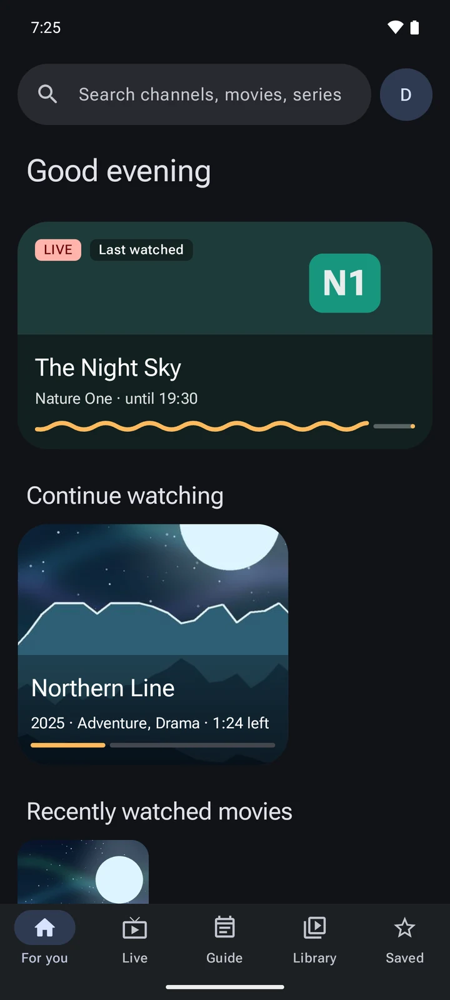</td>
    <td width="33%">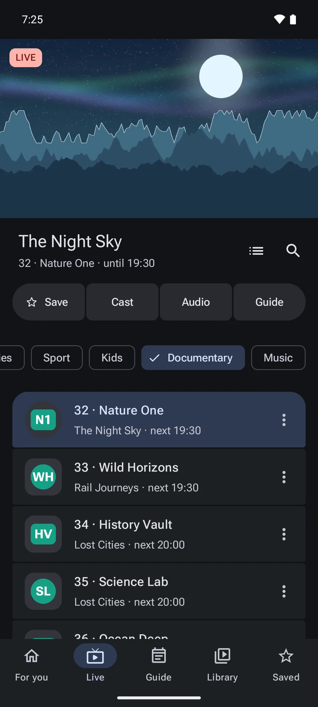</td>
    <td width="33%">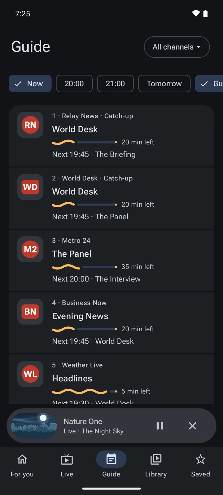</td>
  </tr>
  <tr>
    <td align="center"><sub><b>For you</b></sub></td>
    <td align="center"><sub><b>Live</b></sub></td>
    <td align="center"><sub><b>Guide</b></sub></td>
  </tr>
  <tr>
    <td width="33%">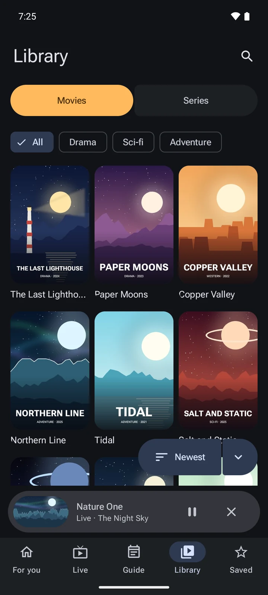</td>
    <td width="33%">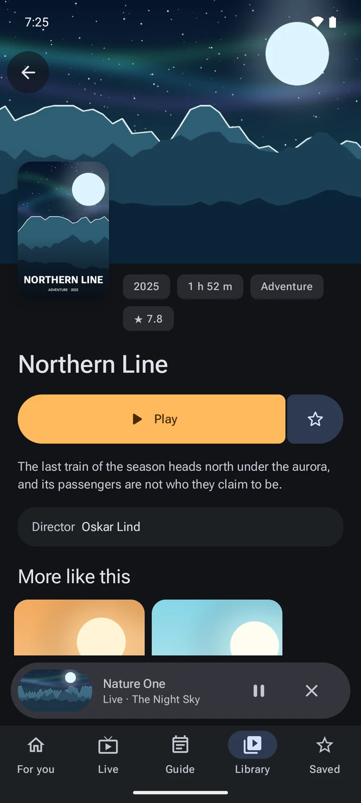</td>
    <td width="33%">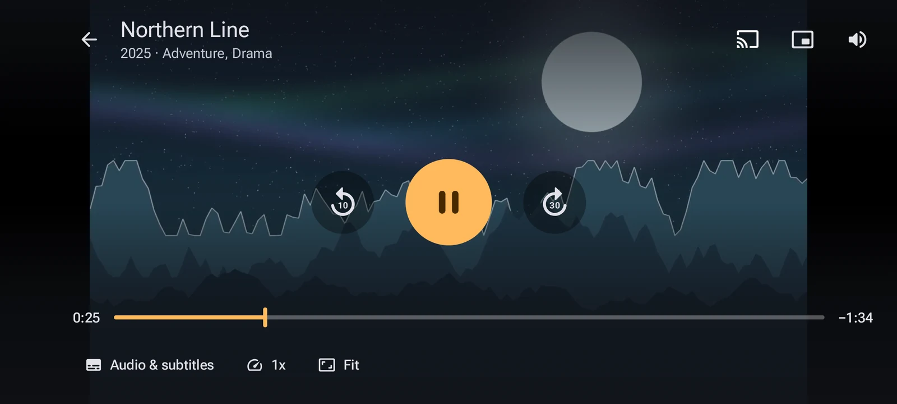</td>
  </tr>
  <tr>
    <td align="center"><sub><b>Library</b></sub></td>
    <td align="center"><sub><b>Details</b></sub></td>
    <td align="center"><sub><b>Player</b> · double-tap a side to skip</sub></td>
  </tr>
</table>

## Install

1. **Download** [`relay-iptv.apk`](https://github.com/Beechey/relay/releases/latest/download/relay-iptv.apk) on the device, and open it. Android asks once to allow installs from your browser or file manager.
2. **On Android TV / Google TV**, the easiest route is the free *Downloader* app: enter this link and install.
   ```
   https://github.com/Beechey/relay/releases/latest/download/relay-iptv.apk
   ```
3. **Sign in** with the server address (including the port, e.g. `http://example.com:8080`), username and password from your provider. Relay downloads your channels, movies, series and guide; a big playlist takes a minute the first time, then opens instantly.

Relay keeps itself up to date: it offers new versions when they're released. Want new features early? Turn on **Beta updates** in *Settings › About and updates*.

## Using it

| | TV remote | Phone |
|---|---|---|
| Open | OK | Tap |
| Options (save, hide a category…) | Hold OK, or the Menu key | Press and hold, or ⋮ |
| Back | Back (again to reach the menu, again for For you) | Back gesture |
| Change channel | Up / Down, or type the number | Swipe up / down in fullscreen |
| Channel list in fullscreen | Hold Left | Back to Live, or ⋮ |
| Skip in a film | Left / Right, or the skip buttons | Double-tap a side |

## Privacy

Relay talks straight to your provider. There's **no Relay server, no account, no analytics and no tracking**. Your login is stored only on the device. The app connects to two places: your provider, and GitHub to check for updates (you can switch that off).

## How it works

- **Catalogue:** channel, movie and series lists are streamed to disk and read back in a compact format, so even playlists with tens of thousands of titles open in seconds and don't run out of memory.
- **TV guide:** the provider's XMLTV guide is parsed as it downloads, keeping two hours back to a day ahead; where a channel isn't covered, Relay asks the provider for its now-and-next.
- **Playback:** AndroidX Media3 (ExoPlayer) with an FFmpeg audio decoder, so live MPEG-TS and HLS, films and episodes play with their audio wherever possible.
- **Chromecast:** the phone reads the live stream and serves it to the TV as short HLS segments over your Wi-Fi, so channels the Cast receiver can't play directly still work.

## Build it yourself

You need **JDK 17** and the **Android SDK** (platform 37.1). Everything else comes with the Gradle wrapper.

```bash
git clone https://github.com/Beechey/relay.git
cd relay
./gradlew :app:assembleDebug        # app/build/outputs/apk/debug/app-debug.apk
./gradlew :app:testDebugUnitTest    # unit tests
```

No provider to test with? [`tools/demo-server`](tools/demo-server) is a small fake Xtream Codes server with invented channels, a rolling guide, films and series; it's what the screenshots above were taken with.

Release builds are signed from the `KEYSTORE_PASSWORD`, `KEY_ALIAS` and `KEY_PASSWORD` environment variables with `app/release.jks`, which is never committed. Pushing a tag such as `v1.2.3` (or `v1.2.3-beta.1` for a pre-release) runs the release workflow, which builds, signs and publishes `relay-iptv.apk` on the [Releases](https://github.com/Beechey/relay/releases) page.

<details>
<summary><b>Project layout</b></summary>

Kotlin and Jetpack Compose throughout. Phones use Material 3 Expressive, TVs Material 3 for TV; each feature folder holds the shared logic plus a phone and a TV layout where they differ.

```
app/src/main/java/com/avetero/relay/
├── MainActivity.kt        picture-in-picture, remote key routing, entry point
├── app/                   AppState, Navigator (one back stack per tab), the phone and TV shells
├── data/
│   ├── model/             channels, movies, series, programmes, resume points
│   ├── xtream/            Xtream Codes API client and streaming JSON parsers
│   ├── epg/               XMLTV guide parser and cache
│   ├── store/             settings, playlists, catalogue cache
│   └── update/            in-app updates from GitHub releases
├── player/                ExoPlayer host, video surface, Chromecast relay
├── ui/
│   ├── theme/             colours, Roboto Flex, TV / phone scaling
│   ├── m3/                phone building blocks (Material 3 Expressive)
│   ├── tv/                TV building blocks (Material 3 for TV)
│   ├── motion/            springs, transitions, shared elements
│   └── components/        small helpers shared by both
├── feature/               home, live, guide, vod, search, favourites, playback,
│                          categories, settings, onboarding, update
└── util/                  date and time formatting
baselineprofile/           records the start-up profile shipped in release builds
tools/demo-server/         fake Xtream Codes server and generated demo media
```

Unit tests mirror the same packages under `app/src/test`.

</details>

## Contributing

Bug reports and pull requests are welcome.

- **Found a bug?** [Open an issue](https://github.com/Beechey/relay/issues) with your device, Android version and what you did. Please never include your provider's address or login.
- **Sending a change?** Keep it small and focused, run the unit tests, and check it on a phone and on a TV (an emulator is fine for both; the [demo server](tools/demo-server) gives you something to look at).
- **Screenshots** in issues and pull requests: please take them with the demo server rather than a real provider, so they show no real channels or artwork.

## Licence

Relay is free software under the [GNU General Public License v3.0](LICENSE). You can use, study, share and change it; anything you distribute that's built from it must be shared under the same licence.

It bundles the FFmpeg audio decoder (GPL-3.0) and the Roboto Flex font ([SIL Open Font License](licenses/RobotoFlex-OFL.txt)). The channels, films, series, artwork and video in the screenshots and the demo server are invented and generated for this project. Android, Android TV and Google TV are trademarks of Google LLC; Relay isn't affiliated with Google or any IPTV provider.
